# ferrite-ui-xl

[ferrite-ui](https://github.com/erhanacunal/ferrite-ui) for RAM-rich, multi-core devices. The first target is a 10" Exynos 4412 tablet (General Mobile eTab4). ferrite-ui stays the version for small boards (GD32F103 Nextion, N32903, F1C100s, ESP32-S3). This repo drops their limits: the renderer runs on its own core and draws through display lists, the GPU composites, and layout and storage are in the firmware.

The `.fl` language, its compiler, the `.fl` library and the Designer are **not** in this repo. They stay in ferrite-ui (one source for both), and this repo uses them from a checkout next to it (`../ferrite-ui`; `sim.bat` takes `%FERRITE_UI%`). Programs written for ferrite-ui run here too. Bytecode that only XL firmware understands is turned on by the device profile (`exynos4412-xl` in ferrite-ui `tools/devices`, its `caps.*`).

The language reference is in ferrite-ui: [ferrite-lang.md](https://github.com/erhanacunal/ferrite-ui/blob/main/docs/ferrite-lang.md), [bytecode.md](https://github.com/erhanacunal/ferrite-ui/blob/main/docs/bytecode.md), [protocol.md](https://github.com/erhanacunal/ferrite-ui/blob/main/docs/protocol.md).

## Hardware: Exynos 4412 tablet (General Mobile eTab4)

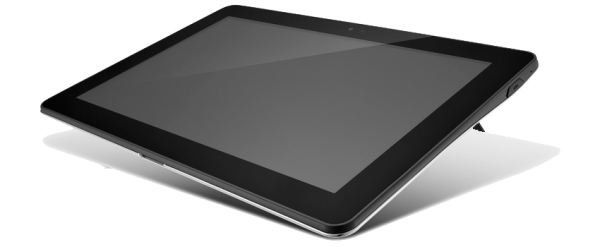

| Component | Part | Details |
|-----------|------|---------|
| CPU | Samsung Exynos 4412 | 4× Cortex-A9 up to 1.4 GHz, MMU + L1/L2 caches. CPU0: VM and UI; CPU1: UART receive; CPU2: render jobs; CPU3: Wi-Fi |
| GPU | Mali-400 MP4 | Composites the screen (widgets as triangles, glyph atlas, textures) and draws 3D models |
| 2D | G2D | Present copies, picture copies, pixel moves, layer copies |
| RAM | 1 GB | 960 MiB heap (the RAM-backed flash image, object pool, decoded images, layers, GPU textures), framebuffers |
| Display | LTN101AL03 | 10.1" 1280×800 LVDS, FIMD XRGB8888; hardware windows for retained layers |
| Touch | Atmel mXT1664S | Capacitive, I2C (the first finger is the pointer) |
| Storage | 16 GB eMMC | CACHE partition (FAT32): firmware, the filesystem image, programs' files, the EEPROM file |
| PMIC / RTC | MAX77686 | Power, RTC |
| Battery | MAX17040, MAX8903 | Fuel gauge and charger (`batteryPercent()`, `chargerState()`) |
| Audio | WM8758 | `playSound` through I2S + DMA (speakers / headphone jack) |
| Wi-Fi | BCM4334 | HTTP dashboard and API, uploads, the `ferrite_cli -p tcp://HOST` protocol bridge |
| UART | UART2 (115200) | Console, `uart_boot` and the ferrite protocol |

HAL: [exynos-4412-rs](https://github.com/erhanacunal/exynos-4412-rs) (git submodule `vendor/exynos_4412_rs`).

## Tablet demo

[`examples/exynos4412/tablet`](examples/exynos4412/tablet): an Android-like launcher and eight apps, each its own program. Its assets are generated by `make_assets.py` (run it before building). Screenshots from the simulator:

<p>
  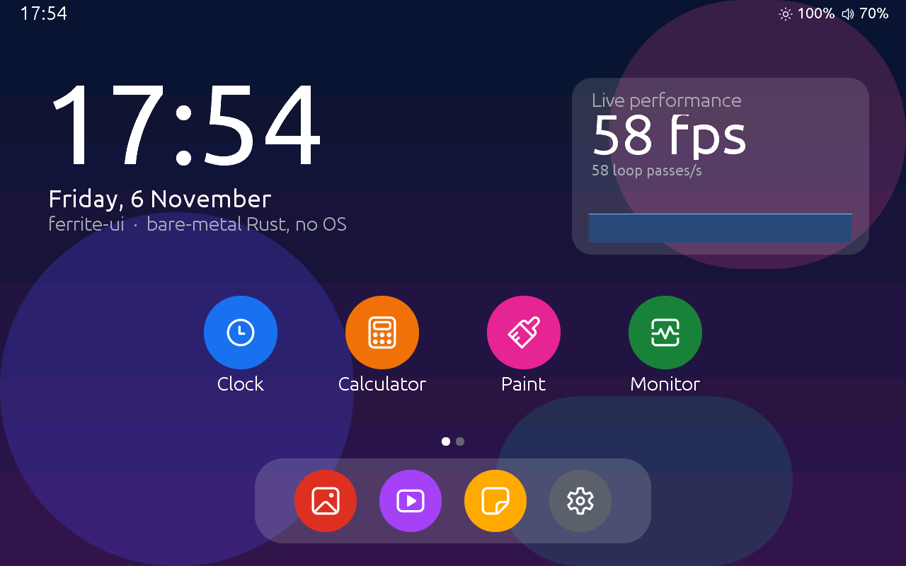
  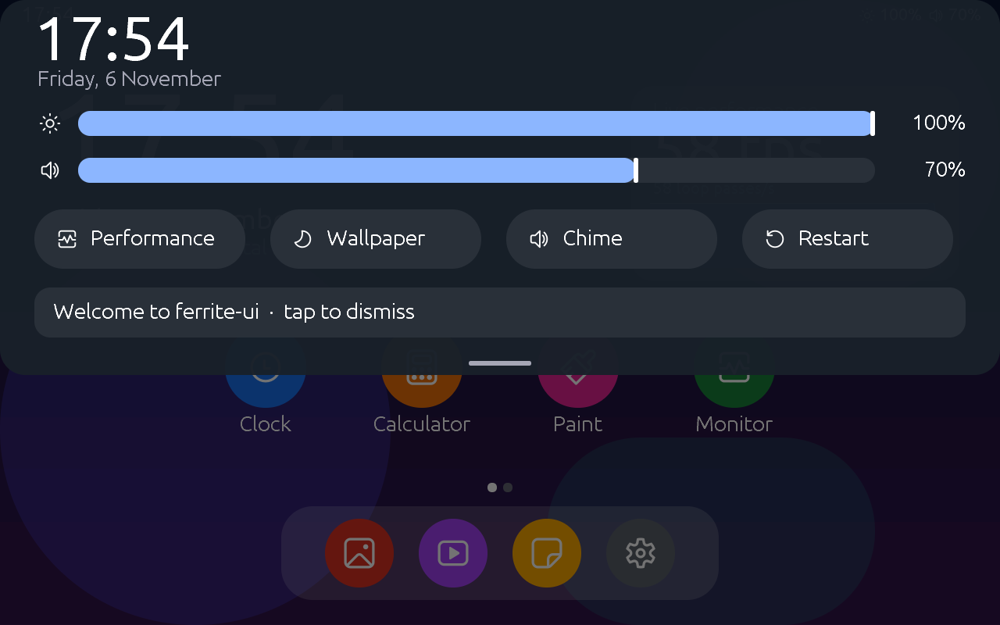
  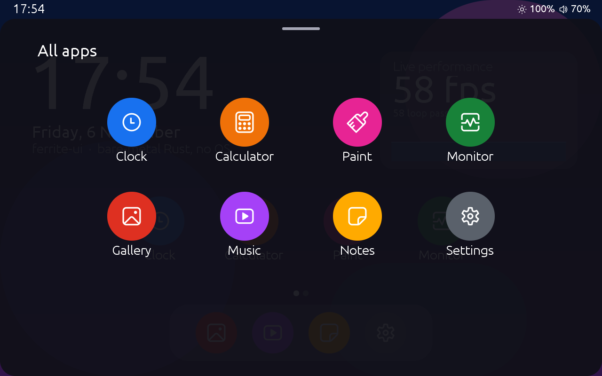
  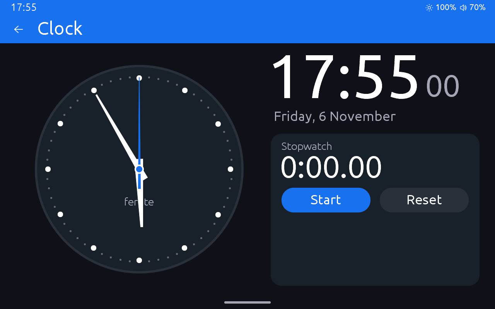
  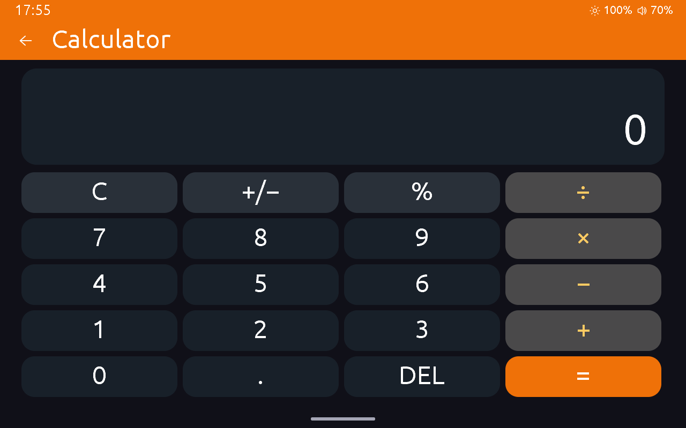
  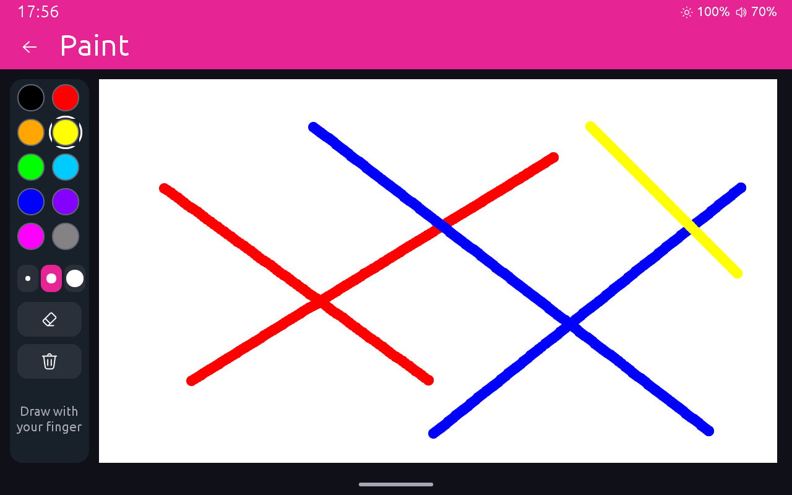
  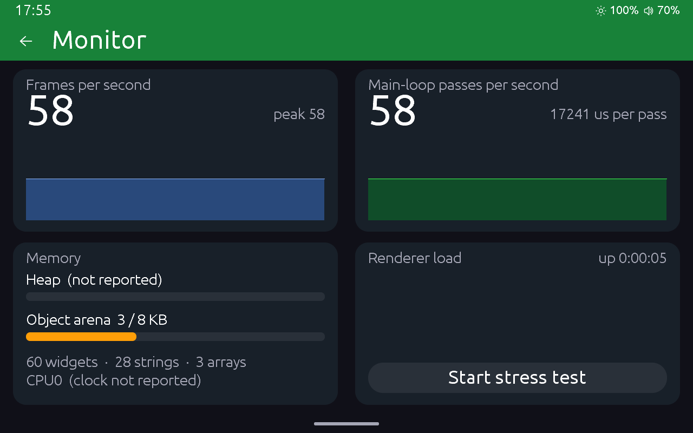
  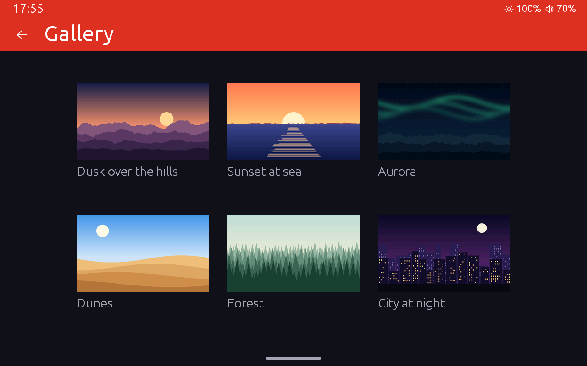
  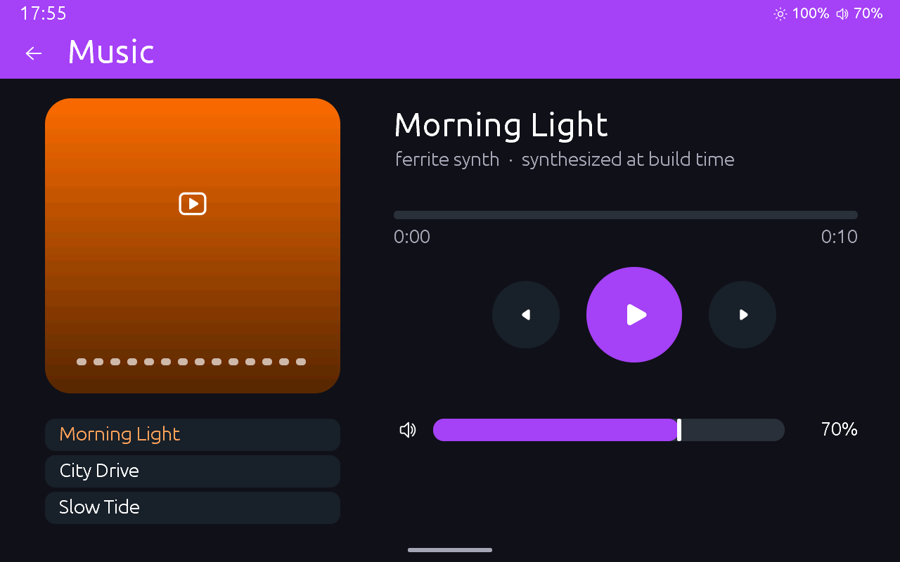
  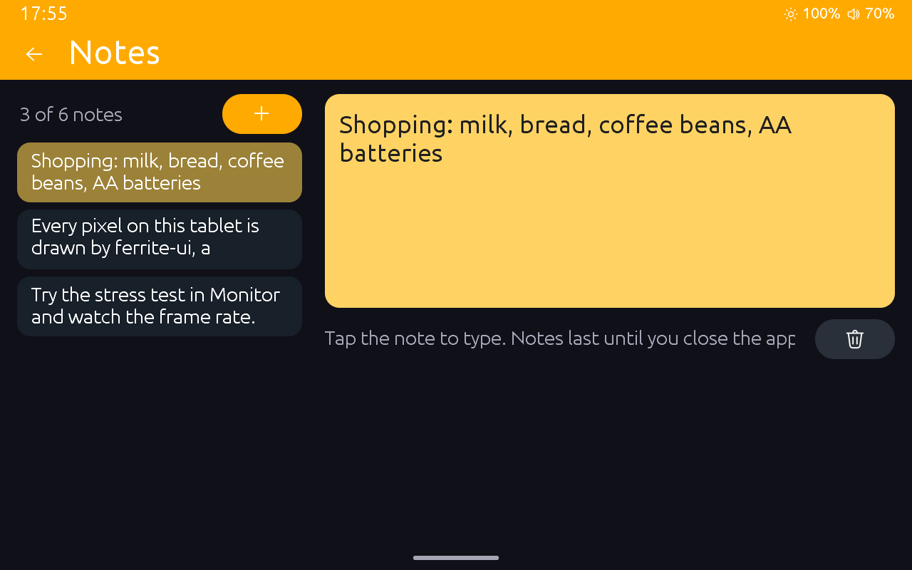
  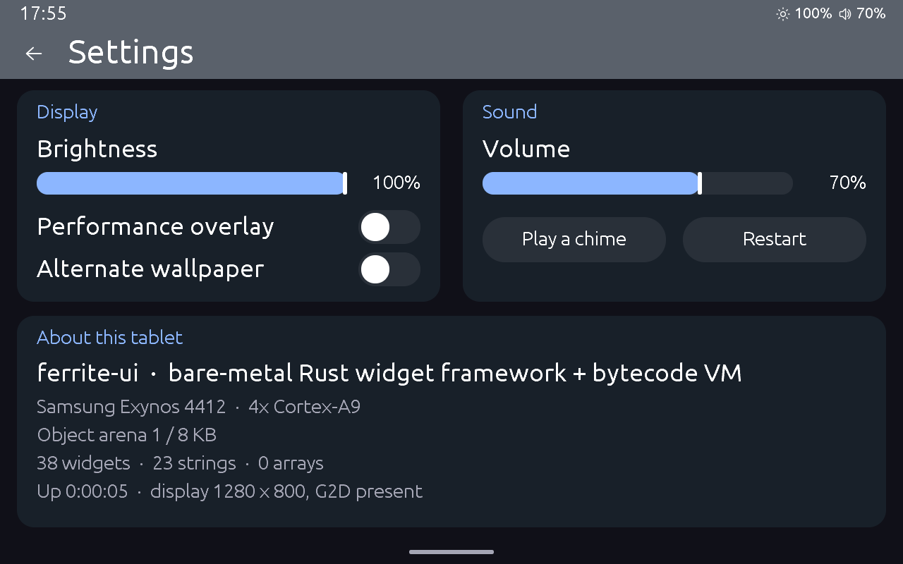
</p>

Other examples in [`examples/exynos4412`](examples/exynos4412): `launcher` (programs switched with `runProgram`), `multitask` (programs running together), `layers`, `scroll`, `paint` (`on_paint`), `model3d`, `jpeg`, `storage` (files, directories, the EEPROM), `gestures` (tap, double tap, long press, drags, pinch, tap-and-drag, a flinging list), `audio_demo`, `bench`.

## How it runs on the board

- **Boot:** the boot partition holds the HAL's `uart_boot`. At power-on it waits 3 s for an image over the UART or Wi-Fi, then boots the saved firmware, `FERRITE/FERRITE.BIN` on CACHE. Hold **volume up** at power-on to stay in `uart_boot`.
- **Drawing:** the VM's core records each frame as a display list; CPU2 plays it, through the GPU where it can and the CPU otherwise. Drawing goes into a shadow buffer whose changed area is copied to the scanned framebuffer at vsync, so there is no tearing and no half-drawn frame. Widget subtrees marked as layers (`set(layer, n)`) can live in the display's hardware windows, so moving or fading them costs no drawing.
- **Filesystem:** the 64 MB flash image (programs, fonts, images, sounds) lives in RAM, loaded from `FERRITE/FLASH.BIN`. A `writefs` changes it until the next boot; `ferrite_cli bootflash` or an HTTP upload saves it.
- **Program storage:** programs can write files and directories (`lib/storage.fl`) under `FERRITE/USER`, their own root: the firmware's files are out of their reach. The EEPROM builtins use 4096 bytes kept in `FERRITE/EEPROM.BIN`.
- **Touch:** every finger is tracked. Widgets take part in Flutter-style gesture recognizers (`onGesture`, `lib/gesture.fl`: tap, double tap, long press, pan and axis drags, scale/rotate, tap-and-drag) that compete in a gesture arena; `on_click` is a tap in that arena, and scroll containers scroll and fling when dragged.
- **Recovery:** hold the top-left 80×80 px for 3 s at boot. Recovery also starts when CACHE has no filesystem yet.
- **Power key:** a short press puts the tablet in standby (another press wakes it). Hold to power off; with volume up to restart; with volume down to restart into fastboot.
- **CPU clock:** set from the HTTP API, throttled by temperature; CPU0 sleeps while nothing changes on the screen.

## Building

Clone with submodules, and clone [ferrite-ui](https://github.com/erhanacunal/ferrite-ui) next to this repo (`../ferrite-ui`): the commands below use its tools. The firmware needs the `armv7a-none-eabihf` target (`rustup target add armv7a-none-eabihf`) and `rust-objcopy` (`cargo install cargo-binutils`, `rustup component add llvm-tools`). The toolchain is pinned in `rust-toolchain.toml`. The tablet must already run the HAL's `uart_boot` from its boot partition (see the [HAL README](https://github.com/erhanacunal/exynos-4412-rs)).

### Firmware

`exynos4412.ps1` does all of it: build, `rust-objcopy` to the raw `.bin` (the ELF alone isn't what boots), and optionally the upload, saved on CACHE as the firmware to boot (`-RamOnly` runs it once):

```powershell
.\exynos4412.ps1                              # build + raw image
.\exynos4412.ps1 uart -Port COM8 [-Monitor]   # + send over UART (restarts a running ferrite first)
.\exynos4412.ps1 http -BoardHost 192.168.88.120 [-Wait 30]   # + send over Wi-Fi
```

`$env:EXYNOS_PORT` / `$env:EXYNOS_HOST` set the defaults. By hand:

```powershell
# Build -> raw image (build from bsp\exynos4412: its .cargo/config.toml selects the target)
cd bsp\exynos4412
cargo build --release
cd ..\..
rust-objcopy -O binary target\armv7a-none-eabihf\release\ferrite-ui target\armv7a-none-eabihf\release\ferrite-ui.bin

# Save it on CACHE as the firmware to boot, then restart into it
python ..\ferrite-ui\tools\ferrite_cli.py --host 192.168.88.120 savefw target\armv7a-none-eabihf\release\ferrite-ui.bin   # over Wi-Fi
python vendor\exynos_4412_rs\tools\uartboot.py --port COMx --reset --save target\armv7a-none-eabihf\release\ferrite-ui.bin   # over UART
```

Without `--save`, `uartboot.py` runs the image from RAM only, until the next restart.

### Programs and resources

```powershell
python ..\ferrite-ui\tools\ferrite_build.py examples\exynos4412\launcher\project.json -o fs.bin
python ..\ferrite-ui\tools\ferrite_cli.py --host 192.168.88.120 bootflash fs.bin --reset   # save as FLASH.BIN, restart
python ..\ferrite-ui\tools\ferrite_cli.py -p COMx writefs fs.bin     # or: until the next boot, over UART
python ..\ferrite-ui\tools\ferrite_cli.py -p tcp://192.168.88.120 writefs fs.bin   # the same over Wi-Fi
python ..\ferrite-ui\tools\ferrite_cli.py -p COMx monitor            # watch the console
```

Wi-Fi needs a `wifi_cfg` file in the image (`ssid=`, `password=`, optional `band=2.4|5`, `hostname=`) plus the chip firmware (`wifi_fw`, `wifi_nvram`) the first time; the board keeps a copy on CACHE, so later images don't need them. Don't commit a `wifi_cfg`: it holds the passphrase.

### HTTP API (Wi-Fi)

`GET /` is a dashboard. `GET /api/status` (link, heap, frames, render core, compositor, CPU, battery, JPEG…), `/api/mem`, `/api/perf?ms=N`, `/api/screen` (a BMP of the screen). Uploads: `POST /flash` (filesystem image, saved and restarted), `POST /save` (firmware), `POST /restart`. Switches for A/B measurements: `/api/cpu?mhz=N`, `/api/backlight?percent=N`, `/api/rcore`, `/api/compose`, `/api/dl`, `/api/idle`, `/api/snapshot`, `/api/layerblit`, `/api/layercache`.

### Simulator

The host simulator is always 1280×800, like the tablet:

```bat
sim.bat examples\exynos4412\tablet
```

or by hand:

```powershell
python ..\ferrite-ui\tools\ferrite_build.py examples\exynos4412\tablet\project.json -o tablet.bin
cargo run --release -p bsp-sim -- --fsimage tablet.bin [--storage DIR] [--eeprom FILE]
```

In the sim, Ctrl + drag adds a second finger mirrored round the screen's centre (pinch, rotate). Scripted input: `--tap X,Y,MS`, `--swipe X0,Y0,X1,Y1,MS[,DUR]`, `--pinch CX,CY,R0,R1,MS[,DUR[,DEG]]`.

### Tests

```powershell
cargo test -p ferrite-core --features host,mock --target x86_64-pc-windows-msvc
python scripts\golden.py          # pixel regression in the sim (--update after an intended visual change)
python scripts\perf_baseline.py   # performance on the board
```

## License

MIT License. See [LICENSE](LICENSE). Third-party code and its licenses are listed in [THIRD_PARTY_NOTICES.md](THIRD_PARTY_NOTICES.md).
